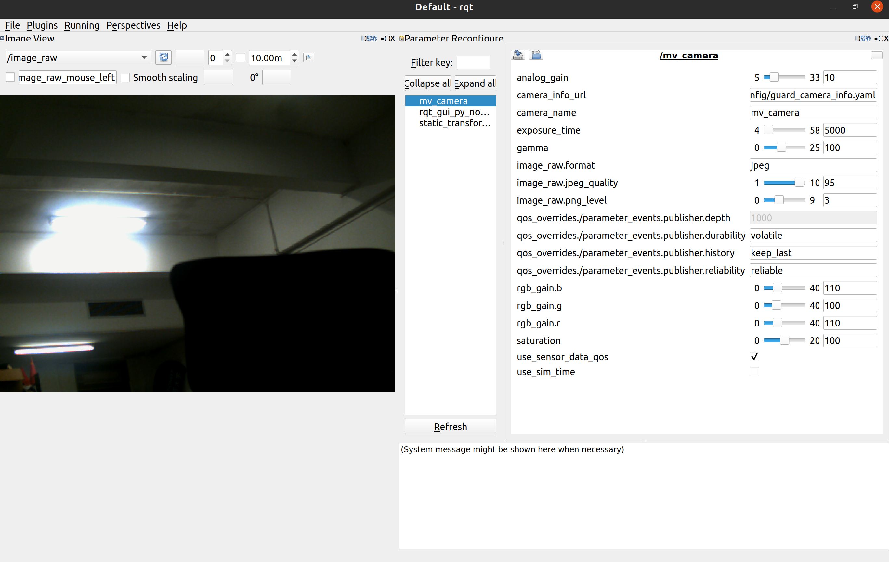

# ros2_mindvision_camera

ROS2 MindVision 相机包，提供了 MindVision 相机的 ROS API。

Only tested under Ubuntu 22.04 with ROS2 Humble

## 使用说明

### Build from source

#### Dependencies

- [Robot Operating System 2 (ROS2)](https://docs.ros.org/en/humble/) (middleware for robotics),

#### Building

To build from source, clone the latest version from this repository into your colcon workspace and compile the package using

	mkdir -p ros_ws/src
	cd ros_ws/src
	git clone https://github.com/chenjunnn/ros2_mindvision_camera.git
	cd ..
	rosdep install --from-paths src --ignore-src -r -y
	colcon build --symlink-install --packages-up-to mindvision_camera

### 标定

标定教程可参考 https://navigation.ros.org/tutorials/docs/camera_calibration.html

参数意义请参考 http://wiki.ros.org/camera_calibration

标定后的相机参数会被存放在 `/tmp/calibrationdata.tar.gz`

### 启动相机节点

    ros2 launch mindvision_camera mv_launch.py

支持的参数：

1. params_file： 相机参数文件的路径 
2. camera_info_url： 相机内参文件的路径
3. use_sensor_data_qos： 相机 Publisher 是否使用 SensorDataQoS (default: `false`)

### 通过 rqt 动态调节相机参数

打开 rqt，在 Plugins 中添加 `Configuration -> Dynamic Reconfigure` 及 `Visualization -> Image View`

1111111111111111111111111111111111111111111111
mindvision

colcon build --packages-select mindvision_camera
rm -rf build install log
colcon build --symlink-install
source install/setup.bash
# 重新构建（启用符号链接，便于调试）

ros2 topic hz /camera_info
ros2 run mindvision_camera mindvision_camera_node

ros2 launch mindvision_camera mv_launch.py

166%
ros2 run camera_calibration cameracalibrator --size 7x10 --square 0.0183 image:=/image_raw camera:=/camera

ros2 run foxglove_bridge foxglove_bridge
ros2 launch rm_vision_bringup vision_bringup.launch.py
ros2 launch rm_vision_bringup no_hardware.launch.py
ros2 launch rm_serial_driver serial_driver.launch.py
rm -rf build  log install
订阅图像话题：
节点会发布 image_raw 话题（类型是 sensor_msgs/Image），你可以用：
ros2 topic echo /image_raw
或者用 rqt_image_view 来查看摄像头图像：
ros2 run rqt_image_view rqt_image_view

ros2 node list
ros2 node info <node_name>
# 示例：
ros2 node info /armor_detector

ros2 topic list
ros2 topic list -t
ros2 topic info <topic_name>
# 示例：
ros2 topic info /image_raw

22222222222222222222222222222222222222222222
detector
[image]

width
1280

height
1024

[narrow_stereo]

camera matrix
1302.988738 0.000000 612.305886
0.000000 1305.940271 531.380066
0.000000 0.000000 1.000000

distortion
-0.503520 0.256280 0.002588 0.002203 0.000000

rectification
1.000000 0.000000 0.000000
0.000000 1.000000 0.000000
0.000000 0.000000 1.000000

projection
1124.407837 0.000000 606.235744 0.000000
0.000000 1194.229736 536.862422 0.000000
0.000000 0.000000 1.000000 0.000000

33333333333333333333333333333333333333333333333333333333
# 检查设备权限（确保有读写权限）
ls -l /dev/ttyACM*

# 测试基础通信（替换为你的设备波特率）
stty -F /dev/ttyACM0 115200 raw -echo
cat /dev/ttyACM0 | hexdump -C  # 另一终端发送数据